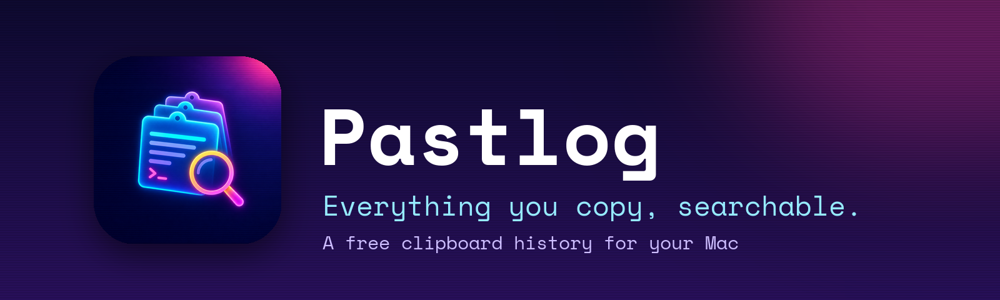
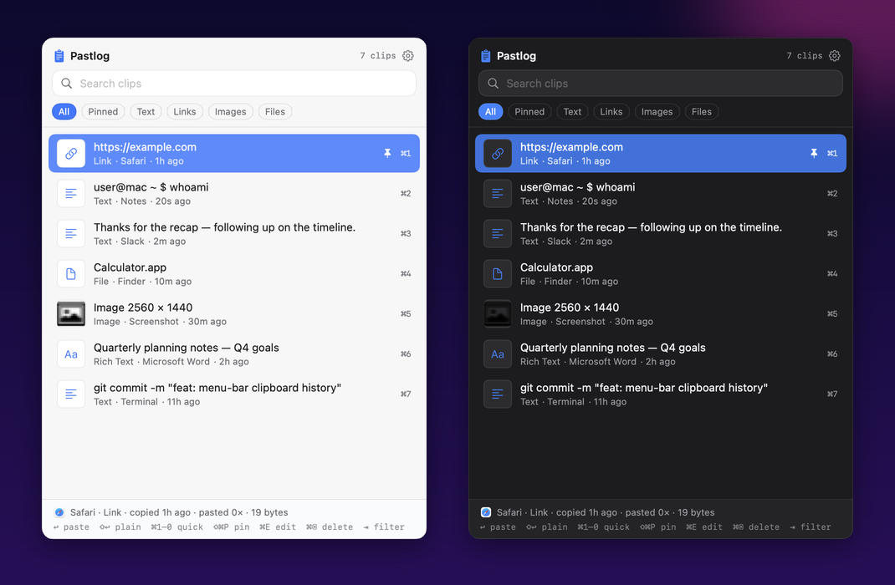
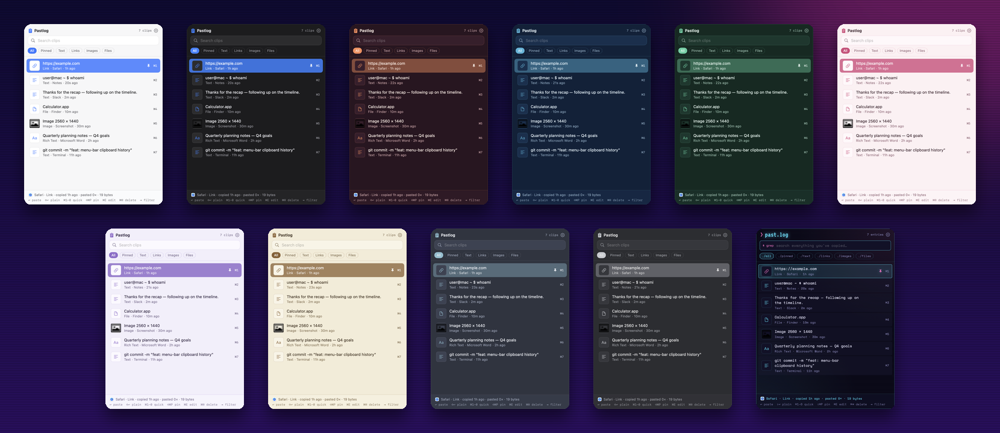

<a href="https://github.com/sviera91/pastlog/releases/latest"><b>Download Pastlog for Mac</b></a>

Pastlog remembers everything you copy on your Mac, so you can find it and paste it again later.

Press **⌃⌘V** (Control + Command + V) to open your history, type to search, and press **Return** to paste.

## Download and install

1. Download **Pastlog-1.0.0.zip** from the [latest release](https://github.com/sviera91/pastlog/releases/latest).
2. Double-click the zip file, then drag **Pastlog** into your **Applications** folder.
3. Open Pastlog. macOS will warn you that it can't verify the app, because Pastlog is free and not registered with Apple. Click **Done**.
4. Open **System Settings → Privacy & Security**, scroll down, and click **Open Anyway** next to Pastlog. You only have to do this once.

Pastlog needs a Mac with Apple silicon (M1 or newer) running macOS 14 or later.

## Let Pastlog paste for you

Pastlog can paste a clip straight into the app you're using. To turn this on, go to **System Settings → Privacy & Security → Accessibility** and switch on **Pastlog**.

If you skip this step, Pastlog still copies the clip, and you press **⌘V** to paste it.

**Pastlog keeps asking for access even though it's switched on?** In that same list, select Pastlog, click **−** to remove it, then click **+** to add it back. Quit and reopen Pastlog.

## What you can do

- Search everything you've copied: text, links, images, and files.
- Pin clips you use often so they're always there.
- Paste with or without formatting. Hold **Shift** when you press **Return** to paste plain text.
- Press **⌘1** through **⌘9** to paste one of your most recent clips.
- Choose from 11 color themes.
- Keep passwords and apps you choose out of your history.

Find all options by clicking the Pastlog icon in the menu bar and choosing **Preferences**.

## Your privacy

Your history stays on your Mac. Pastlog doesn't upload or share anything.

## Help and feedback

Found a problem or have an idea? [Open an issue](https://github.com/sviera91/pastlog/issues).

Developers: see [CONTRIBUTING.md](CONTRIBUTING.md).

## License

Free and open source under the [MIT License](LICENSE).
